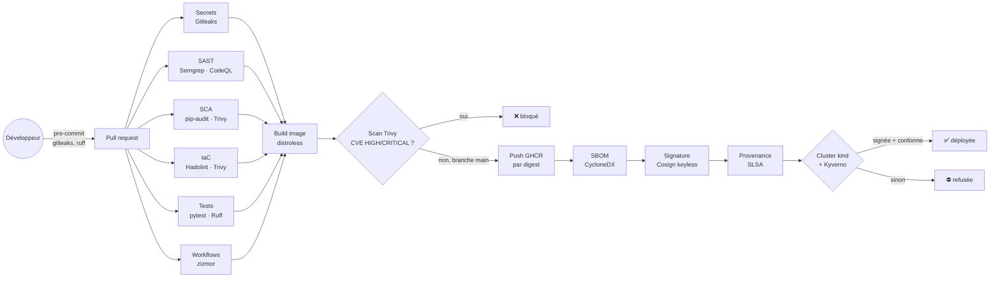
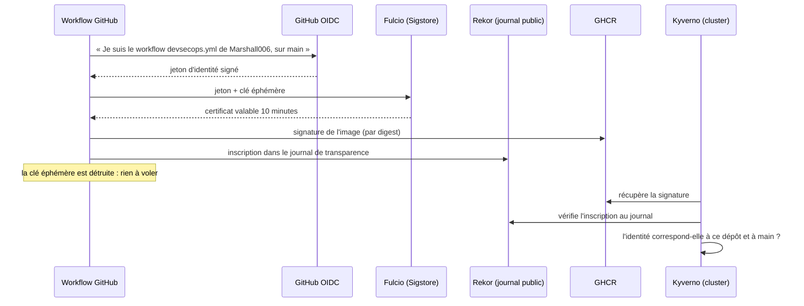

# 🛡️ DevSecOps Pipeline — chaîne d'approvisionnement logicielle sécurisée

[](https://github.com/Marshall006/devsecops-pipeline/actions/workflows/devsecops.yml)
[](https://github.com/Marshall006/devsecops-pipeline/actions/workflows/security-gate-demo.yml)
[](https://github.com/Marshall006/devsecops-pipeline/actions/workflows/codeql.yml)
[](https://securityscorecards.dev/viewer/?uri=github.com/Marshall006/devsecops-pipeline)


> Une chaîne CI/CD qui fait passer chaque modification au crible (secrets,
> code, dépendances, configuration, image), **signe** l'image produite,
> publie son **inventaire (SBOM)** et sa **provenance**, puis prouve sur un
> **vrai cluster Kubernetes** que seules les images signées et conformes
> peuvent y être déployées.

**Compétences démontrées :** DevSecOps · shift-left security · SAST
(Semgrep, CodeQL) · SCA (pip-audit, Trivy) · détection de secrets (Gitleaks) ·
scan d'IaC (Hadolint, Trivy) · sécurité des conteneurs (images distroless,
non-root) · SBOM (CycloneDX) · signature keyless (Sigstore/Cosign) · SLSA ·
policy-as-code (Kyverno 1.20, CEL) · sécurité de la CI elle-même (actions
épinglées par SHA, permissions minimales, zizmor, OpenSSF Scorecard).

---

## Sommaire

1. [Pourquoi ce projet](#-pourquoi-ce-projet)
2. [Architecture de la chaîne](#️-architecture-de-la-chaîne)
3. [Stack technique détaillée](#-stack-technique-détaillée)
4. [Les contrôles, un par un](#-les-contrôles-un-par-un)
5. [La preuve que ça marche](#-la-preuve-que-ça-marche)
6. [Sécuriser le pipeline lui-même](#-sécuriser-le-pipeline-lui-même)
7. [Vérifier une image publiée](#-vérifier-une-image-publiée)
8. [Lancer les contrôles en local](#-lancer-les-contrôles-en-local)
9. [Structure du dépôt](#-structure-du-dépôt)
10. [Choix techniques](#-choix-techniques)

---

## 🎯 Pourquoi ce projet

Les attaques ne visent plus seulement le code, mais **la chaîne qui le
construit**. Le 19 mars 2026, l'attaque « TeamPCP » a réécrit 76 des 77 tags
de la GitHub Action `aquasecurity/trivy-action` pour voler les secrets des
pipelines qui l'utilisaient. Seuls les dépôts qui épinglaient l'action **par
SHA de commit** étaient protégés.

Ce projet applique les réponses modernes à ce type de menace :

| Question | Réponse apportée |
|---|---|
| Le code contient-il une faille ou un secret ? | Gitleaks, Semgrep, CodeQL |
| Une dépendance est-elle vulnérable ? | pip-audit, Trivy, Dependabot |
| L'image est-elle saine ? | Image distroless + scan Trivy bloquant |
| Que contient exactement l'image ? | **SBOM** CycloneDX attaché à l'image |
| Qui a construit cette image, et comment ? | **Signature Sigstore** + **provenance SLSA** |
| Peut-on déployer une image piégée ou non conforme ? | **Non** : Kyverno la refuse à l'entrée du cluster |
| Le pipeline lui-même est-il sûr ? | Actions épinglées par SHA, permissions minimales, zizmor, Scorecard |

## 🏗️ Architecture de la chaîne



### Signature « keyless » : comment ça marche



## 🧰 Stack technique détaillée

| Catégorie | Outil | Rôle | Pourquoi ce choix |
|---|---|---|---|
| **Application** | FastAPI, Pydantic, `Decimal` | API de facturation HT/TVA/TTC (TVA Bénin 18 %) | Validation stricte, aucun float pour l'argent |
| **Secrets** | **Gitleaks** 8.30 | Cherche des secrets dans **tout l'historique** Git | Un secret supprimé reste dans l'historique |
| **SAST** | **Semgrep** | Règles Python, OWASP Top 10, secrets | Rapide, règles lisibles |
| **SAST** | **CodeQL** | Analyse sémantique (Python + workflows Actions) | Moteur de GitHub, onglet Security |
| **SCA** | **pip-audit** | Dépendances Python vs base OSV / PyPI Advisory | Outil officiel de la PyPA |
| **SCA / image / IaC** | **Trivy** 0.76 | Vulnérabilités des dépendances et de l'image, mauvaises configurations | Scanner polyvalent ; utilisé par image versionnée (pas par l'action compromise) |
| **Dockerfile** | **Hadolint** | Bonnes pratiques Dockerfile | Référence du linting Docker |
| **Dépendances** | pip-tools `--generate-hashes` | Chaque paquet vérifié par son empreinte SHA-256 | Bloque un paquet substitué |
| **Image** | **Chainguard** python (distroless) | Pas de shell, pas de gestionnaire de paquets, non-root | Surface d'attaque minimale, quasi zéro CVE |
| **SBOM** | **Syft** (CycloneDX) | Inventaire de tous les composants de l'image | Exigé par de plus en plus de réglementations (Cyber Resilience Act) |
| **Signature** | **Cosign** keyless (Sigstore) | Signe l'image et atteste le SBOM | Aucune clé privée à stocker |
| **Provenance** | **SLSA** (GitHub attestations) | Prouve où, quand et comment l'image a été construite | Standard de l'OpenSSF |
| **Admission** | **Kyverno 1.20** (CEL) | `ImageValidatingPolicy` + 4 `ValidatingPolicy` | Policy-as-code ; format CEL actuel (ClusterPolicy est supprimée depuis 1.20) |
| **Cluster de test** | **kind** | Kubernetes éphémère dans la CI | Tests d'admission réels |
| **Sécurité de la CI** | **zizmor** | Audite les workflows (injections, permissions, épinglage) | Linter de sécurité dédié à GitHub Actions |
| **Hygiène du dépôt** | **OpenSSF Scorecard** | Note la sécurité du projet | Indicateur reconnu |
| **Mises à jour** | **Dependabot** | PR automatiques (pip, Docker, Actions) | Chaque PR repasse par toute la chaîne |
| **Poste développeur** | **pre-commit** | Gitleaks et Ruff avant chaque commit | Le secret n'atteint jamais GitHub |

## 🔎 Les contrôles, un par un

| Étape | Bloque si… | Où voir le résultat |
|---|---|---|
| Gitleaks | un secret est présent dans l'historique | logs du job |
| Semgrep | une règle de sécurité est violée | onglet **Security** (SARIF) |
| CodeQL | une faille est détectée dans le code ou les workflows | onglet **Security** |
| pip-audit | une dépendance a une vulnérabilité connue | logs du job |
| Trivy (dépendances) | CVE HIGH ou CRITICAL | onglet **Security** |
| Hadolint | mauvaise pratique Dockerfile (niveau warning) | logs du job |
| Trivy (IaC) | mauvaise configuration HIGH ou CRITICAL | logs du job |
| zizmor | faille dans un workflow GitHub Actions | logs du job |
| Trivy (image) | CVE HIGH ou CRITICAL **corrigeable** dans l'image | onglet **Security** |
| Test de fumée | l'API ne répond pas, ou un shell est présent dans l'image | logs du job |
| Kyverno | voir ci-dessous | résumé du job |

### Politiques d'admission (Kyverno)

| Politique | Type | Refuse |
|---|---|---|
| `require-signed-images` | ImageValidatingPolicy | toute image `ghcr.io/marshall006/*` non signée par **ce dépôt, sur main** |
| `restrict-image-registries` | ValidatingPolicy | toute image hors de `ghcr.io/marshall006/` |
| `disallow-latest-tag` | ValidatingPolicy | `:latest` ou absence de tag |
| `pod-security-restricted` | ValidatingPolicy | root, privilégié, escalade de privilèges, capabilities, seccomp, réseau de l'hôte |
| `require-resources` | ValidatingPolicy | conteneur sans requêtes CPU/mémoire ni limite mémoire |

## ✅ La preuve que ça marche

Un contrôle de sécurité qui ne déclenche jamais d'alerte peut tout aussi bien
être cassé. Deux mécanismes le vérifient en continu.

**1. Contre-épreuve des scanners** ([`demo/vulnerable-app`](demo/vulnerable-app)) :
une application **volontairement vulnérable** (injection SQL, injection de
commande, `pickle`, `eval`, dépendances obsolètes, Dockerfile en root).
Le workflow `security-gate-demo.yml` **réussit seulement si chaque scanner
échoue** dessus.

**2. Tests d'admission sur cluster réel** ([`scripts/admission-tests.sh`](scripts/admission-tests.sh)) :

| Scénario | Attendu |
|---|---|
| Image avec le tag `latest` | ⛔ refusée par `disallow-latest-tag` |
| Image d'un registre public | ⛔ refusée par `restrict-image-registries` |
| Pod privilégié en root | ⛔ refusé par `pod-security-restricted` |
| Conteneur sans limites | ⛔ refusé par `require-resources` |
| Image de notre registre **non signée** par ce dépôt | ⛔ refusée par `require-signed-images` |
| **Image signée** par ce pipeline | ✅ déployée, `/health` répond |

## 🔐 Sécuriser le pipeline lui-même

- **Actions épinglées par SHA de commit** (avec la version en commentaire),
  mises à jour par Dependabot.
- **`permissions: {}`** au niveau du workflow, puis le strict nécessaire par
  job : `id-token: write` seulement là où l'on signe, `packages: write`
  seulement là où l'on publie.
- **`persist-credentials: false`** : le jeton Git n'est pas laissé sur le
  disque du runner.
- Aucune valeur contrôlée par l'utilisateur interpolée dans un script
  (protection contre l'injection) : passage par des variables d'environnement.
- **Trivy utilisé par image Docker versionnée**, pas via l'action compromise.
- **zizmor** audite les workflows à chaque modification ; **Scorecard** note
  le dépôt chaque semaine.

## 🔏 Vérifier une image publiée

```bash
# Signature : construite par CE dépôt, sur main ?
cosign verify ghcr.io/marshall006/invoice-api:main \
  --certificate-oidc-issuer https://token.actions.githubusercontent.com \
  --certificate-identity-regexp '^https://github\.com/Marshall006/devsecops-pipeline/'

# Provenance SLSA
gh attestation verify oci://ghcr.io/marshall006/invoice-api:main --owner Marshall006

# SBOM attaché
cosign verify-attestation ghcr.io/marshall006/invoice-api:main --type cyclonedx \
  --certificate-oidc-issuer https://token.actions.githubusercontent.com \
  --certificate-identity-regexp '^https://github\.com/Marshall006/devsecops-pipeline/' \
  | jq -r '.payload' | base64 -d | jq '.predicate.components | length'
```

## 💻 Lancer les contrôles en local

```bash
make hooks    # installe les hooks pre-commit
make test     # tests unitaires
make sast     # Semgrep
make sca      # pip-audit
make iac      # Hadolint + Trivy
make image    # build + scan de l'image
make verify   # vérifie la signature de l'image publiée
```

## 📁 Structure du dépôt

```
devsecops-pipeline/
├── app/                        # API + Dockerfile distroless + dépendances hachées
├── deploy/invoice-api.yaml     # déploiement conforme au profil « restricted »
├── policies/                   # 5 politiques Kyverno (CEL) + pods de test
├── scripts/admission-tests.sh  # tests d'admission sur cluster réel
├── demo/vulnerable-app/        # contre-épreuve volontairement vulnérable
├── .github/
│   ├── workflows/
│   │   ├── devsecops.yml           # chaîne principale
│   │   ├── security-gate-demo.yml  # contre-épreuve
│   │   ├── codeql.yml
│   │   └── scorecard.yml
│   └── dependabot.yml
├── .pre-commit-config.yaml
└── SECURITY.md
```

## 🧠 Choix techniques

| Décision | Alternative écartée | Raison |
|---|---|---|
| Actions épinglées par SHA | Tags `@v4` | Un tag peut être déplacé (attaque trivy-action, mars 2026) |
| Trivy par image Docker versionnée | `aquasecurity/trivy-action` | Moins d'intermédiaires de confiance |
| Signature keyless (OIDC) | Paire de clés Cosign | Aucune clé privée à protéger ni à faire tourner |
| Kyverno `ValidatingPolicy` (CEL) | `ClusterPolicy` | Supprimée dans Kyverno 1.20 |
| Image Chainguard distroless | `python:slim` | Pas de shell ni de gestionnaire de paquets, quasi zéro CVE |
| `--require-hashes` | Versions épinglées seules | Protège contre un paquet substitué à version identique |
| Scan d'image avec `--ignore-unfixed` | Tout bloquer | On bloque ce qu'on peut corriger ; le reste est suivi dans l'onglet Security |
| Contre-épreuve automatisée | Faire confiance aux scanners | Un contrôle qui ne détecte jamais rien peut être cassé |

## 👤 Auteur

**Soumaïla Cissé Piénikoua IDANI** — [GitHub @Marshall006](https://github.com/Marshall006)

Projet 4/6 d'un portfolio **IA / MLOps · Cloud · DevOps** :
[1. MLOps Credit Risk](https://github.com/Marshall006/mlops-credit-risk) ·
[2. RAG Agent](https://github.com/Marshall006/rag-agent-assistant) ·
[3. K8s GitOps Platform](https://github.com/Marshall006/k8s-gitops-platform) ·
**4. DevSecOps Pipeline**
